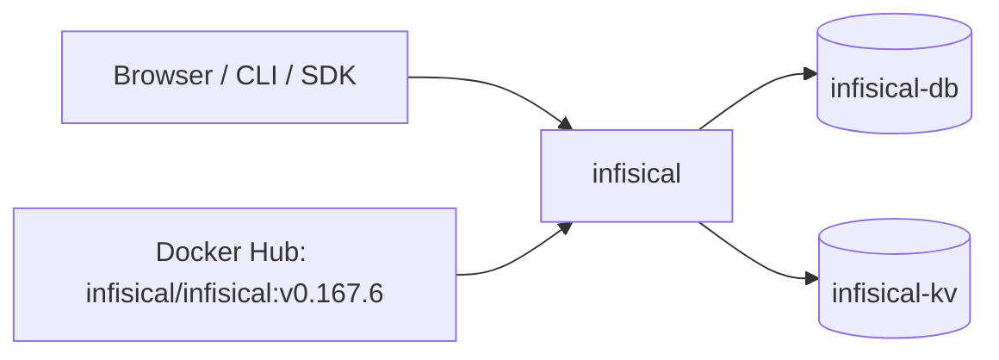

<div align="center">

# Infisical on Render

An open source secrets manager. Store, sync, and rotate API keys, database credentials, and certificates across your team and infrastructure. This repo is the Blueprint. The app runs from the official [Infisical](https://github.com/Infisical/infisical) Docker image.

<p>
  <a href="https://render.com/deploy-template/api/github/start?template_repo=infisical">
    
  </a>
</p>

<p>
  <a href="https://render.com">
    
  </a>
  <a href="https://github.com/Infisical/infisical">
    
  </a>
  <a href="https://github.com/Infisical/infisical/blob/main/LICENSE">
    
  </a>
</p>

</div>

## What This Template Shows

This repository does not contain the Infisical source. The service pulls the official image from Docker Hub at a pinned version. To upgrade, change the tag in [`render.yaml`](./render.yaml) and push.

| Piece | Role |
| --- | --- |
| **[Infisical](https://github.com/Infisical/infisical)** | Web UI, API, secret syncs, dynamic secrets, PKI, and the backend for the Infisical CLI and SDKs. |
| **`infisical`** ([Web Service](https://render.com/docs/web-services)) | The app and API. Runs database migrations on startup. |
| **`infisical-db`** ([Render Postgres](https://render.com/docs/postgresql)) | Encrypted secrets, projects, users, and audit logs. |
| **`infisical-kv`** ([Render Key Value](https://render.com/docs/key-value)) | Cache and job queues. |

## Architecture



### How It Works

1. Click **Deploy to Render**. The flow copies this repo into your GitHub account and applies [`render.yaml`](./render.yaml).
2. Render creates the database and Key Value instance and generates `ENCRYPTION_SEED` and `AUTH_SECRET`. There is nothing to fill in.
3. The start command sets `ENCRYPTION_KEY` to the first 32 characters of `ENCRYPTION_SEED`, then starts Infisical. Infisical migrates Postgres and starts serving.
4. Open the service URL and create the first account. It becomes the instance admin.

| Resource | Type | Plan | Notes |
| --- | --- | --- | --- |
| `infisical` | Web, image | Standard | Health: `/api/status`. Starter (512 MB) runs out of memory during first-boot migrations. |
| `infisical-kv` | Key Value | Starter | `noeviction`, so queued jobs are never dropped. Internal connections only. |
| `infisical-db` | Postgres 16 | Basic 256 MB | Internal connections only. |

Default region: **Oregon**.

### Why the start command slices a key

Infisical uses `ENCRYPTION_KEY` directly as an AES-256 key, so it must be exactly 32 characters. Blueprint `generateValue` makes a longer random string. The start command keeps the first 32 characters, so every deploy gets a unique key without a manual step.

## Quick Start

1. Click **Deploy to Render** above.
2. Wait until `infisical` is **Live**.
3. Open the service URL and sign up. The first account is the admin. Later sign-ups need an invite.
4. **Back up `ENCRYPTION_SEED`** from the service's **Environment** page and store it outside Render. You can't decrypt your secrets without it.

```bash
curl -fsS "https://<infisical>.onrender.com/api/status"
```

## Configuration

| Variable | Source | Description |
| --- | --- | --- |
| `ENCRYPTION_SEED` | Generated | Its first 32 characters are the `ENCRYPTION_KEY`. Never change it. |
| `AUTH_SECRET` | Generated | Signs session tokens. Changing it signs everyone out. |
| `DB_CONNECTION_URI` | Wired | Internal URL of `infisical-db`. |
| `REDIS_URL` | Wired | Internal URL of `infisical-kv`. |
| `SITE_URL` | Wired | The service's `RENDER_EXTERNAL_URL`. Used in emails, OAuth redirects, and links. |
| `TELEMETRY_ENABLED` | Blueprint | `false`. |
| `SMTP_*` | Optional | Invites, email verification, and password resets. See [`.env.example`](./.env.example). |

`generateValue` runs once, on the first Blueprint apply.

## Cost

Prices from [Render's pricing page](https://render.com/pricing).

| Resource | Approx. monthly |
| --- | ---: |
| `infisical` (Standard, 2 GB) | $25 |
| `infisical-kv` (Starter) | $10 |
| `infisical-db` (Basic 256 MB) | $6 |
| **Total** | **~$41** |

Standard is the floor. Infisical peaked at about 690 MB during first-boot migrations and settles around 555 MB.

## Troubleshooting

| Problem | Solution |
| --- | --- |
| First deploy fails with `ECONNREFUSED ...:5432` | The service started before `infisical-db` accepted connections. Wait for the database to be **Available** and click **Manual Deploy**. |
| Deploy fails with `Out of memory (used over 512Mi)` | The service is on Starter. Use Standard or larger. |
| Secrets fail to decrypt after a change | `ENCRYPTION_SEED` changed. Restore the old value. |
| Everyone is signed out | `AUTH_SECRET` changed. Expected after a rotation. |
| Invite or verification emails never arrive | Set the `SMTP_*` variables. |
| Links in emails point at the wrong host | `SITE_URL` must be the public URL. Update it after you add a custom domain. |

## Project Structure

```
render.yaml       Blueprint. One image-backed web service, Key Value, and Postgres.
README.md         This file
LICENSE           Wrapper license
.env.example      Optional extras
```

## Learn More

- [Blueprint spec](https://render.com/docs/blueprint-spec)
- [Infisical self-hosting docs](https://infisical.com/docs/self-hosting/overview)
- [Infisical on GitHub](https://github.com/Infisical/infisical)

## License

[MIT](LICENSE) for this wrapper.

Infisical is MIT licensed, except code under `ee/` directories, which is under the [Infisical Enterprise license](https://github.com/Infisical/infisical/blob/main/ee/LICENSE). Enterprise features need a license key.
